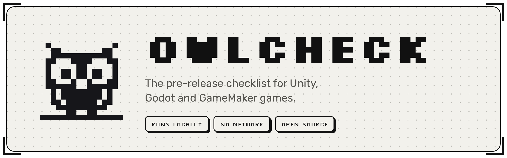
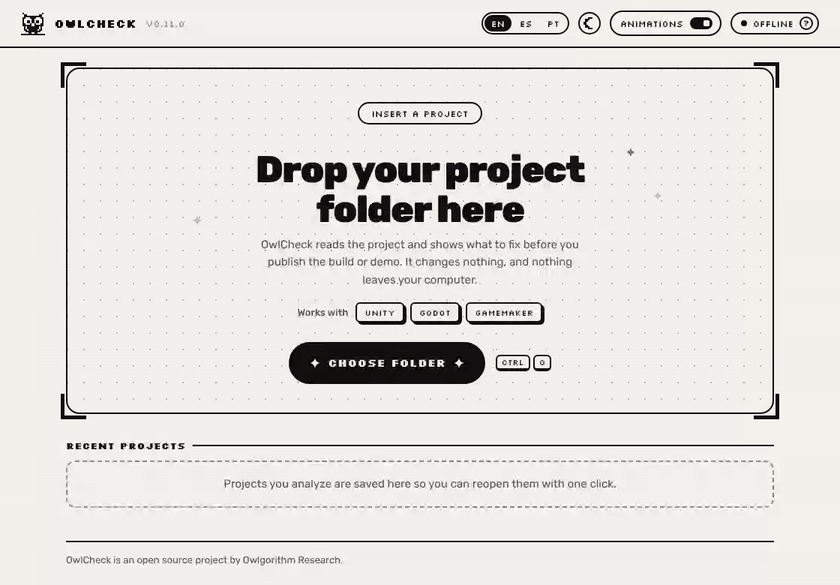
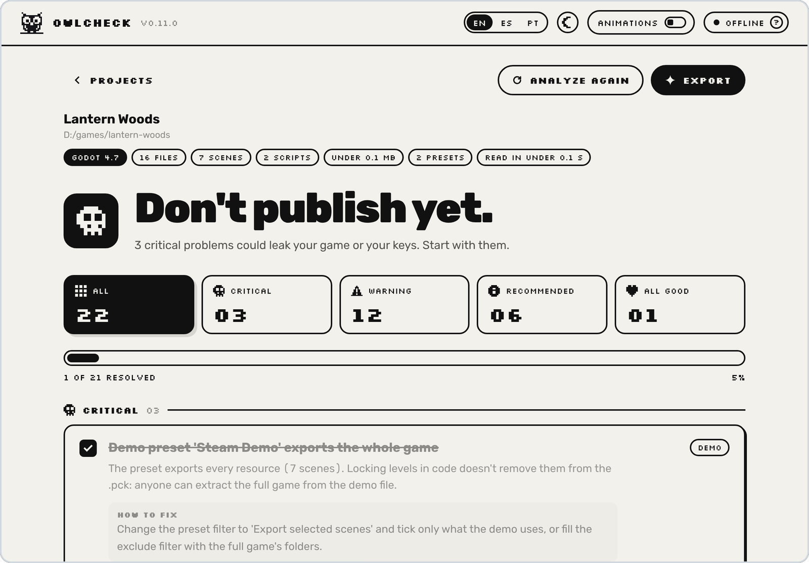
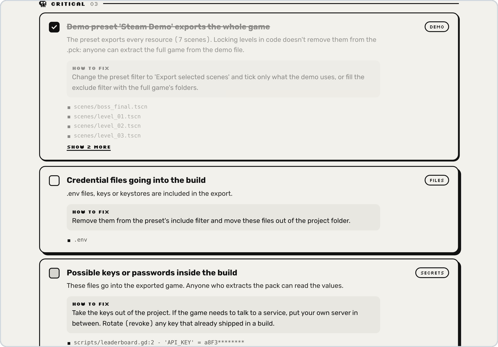
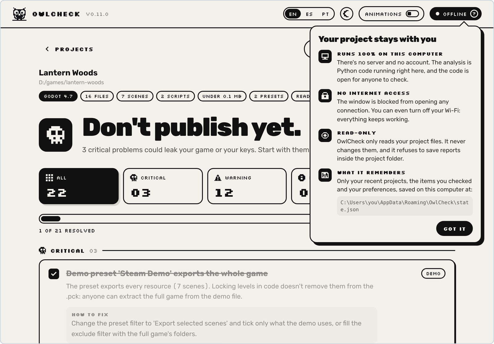
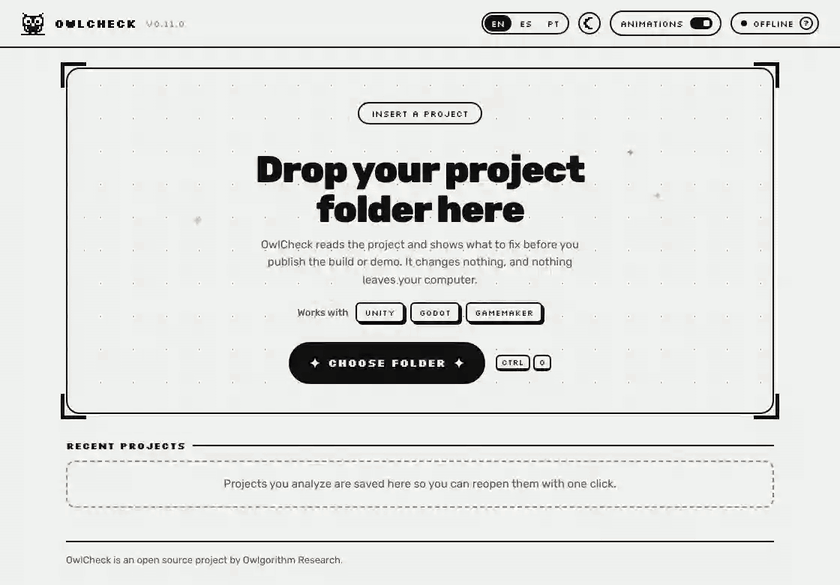
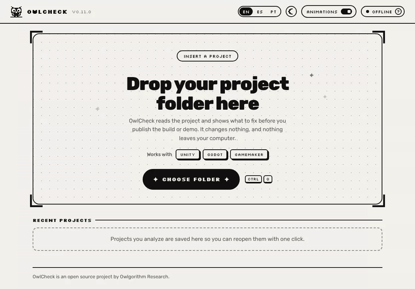

<picture>
  <source media="(prefers-color-scheme: dark)" srcset="docs/media/header-dark.png">
  
</picture>

<p align="center"><b>English</b> &nbsp;|&nbsp; <a href="README.pt-BR.md">Português</a></p>

OwlCheck reads your game project and tells you, in plain words, what to fix before you publish a build or a demo: a demo that ships the whole game, an API key sitting in a script, test scenes and cheat menus left behind, metadata still at the engine's defaults, fonts and plugins without a license.

It runs on your computer, never connects to the internet and never changes your project.

<p align="center">
  
</p>

## Why

Indie games get ripped, re-uploaded and data-mined, and most leaks aren't clever hacks. They're a demo export that includes every level, a webhook URL in a script, an `.env` file that slipped into the pack, a debug menu nobody turned off. OwlCheck catches those boring mistakes while they're still cheap to fix.

## Install

Download the file for your system from the [latest release](https://github.com/owlgorithm-research/owlcheck/releases/latest). Every file there is built by GitHub Actions from this repository.

OwlCheck isn't code-signed yet, so Windows and macOS warn you the first time you open it. The steps below say what to click.

### Windows 10 and 11

**With the installer**

1. Download `OwlCheck-Setup.exe` and open it.
2. If Windows shows *Windows protected your PC*, click **More info**, then **Run anyway**.
3. Pick a language, click **Next** and choose whether you want a desktop shortcut.
4. Leave **Open OwlCheck** ticked and click **Finish**.

It installs for your user only, without an administrator password, and adds OwlCheck to the Start menu. To update, run the installer of the new version over the old one: your recent projects and ticked items stay. To uninstall, open *Settings > Apps > Installed apps*, find OwlCheck and choose **Uninstall**.

**Portable, without installing**

1. Download `OwlCheck-Windows.zip`, right-click it and choose **Extract All**.
2. Open the `OwlCheck` folder and double-click `OwlCheck.exe`. The first time, Windows shows the same warning as above.

`OwlCheck.exe` needs the files next to it. To move it, move the whole folder.

> On PCs with Smart App Control turned on, Windows blocks unsigned apps and offers no way to run them. OwlCheck will open there once it's signed.

### macOS

For Macs with Apple silicon (M1 or newer).

1. Download `OwlCheck-macOS.zip` and double-click it to get `OwlCheck.app`.
2. Drag `OwlCheck.app` to your **Applications** folder.
3. Open it. macOS says it couldn't verify the app; click **Done**.
4. Open *System Settings > Privacy & Security*, scroll down to the message about OwlCheck and click **Open Anyway**. Confirm with your password or Touch ID.

From then on it opens like any other app. To update, replace it in Applications with the new version. To uninstall, drag it to the Trash; its preferences are in `~/Library/Application Support/OwlCheck`.

### Linux

For 64-bit PCs, built on Ubuntu 22.04.

```bash
tar -xzf OwlCheck-Linux.tar.gz
./OwlCheck
```

If the window doesn't open, install the system libraries it uses (Debian and Ubuntu names):

```bash
sudo apt install libegl1 libxkbcommon-x11-0 libxcb-cursor0 libnss3
```

Its preferences are in `~/.config/owlcheck`.

### Check the download

Each release has a `SHA256SUMS.txt`. To confirm a file wasn't changed on the way, compare its hash with the one listed there:

| System | Command |
|---|---|
| Windows (PowerShell) | `Get-FileHash OwlCheck-Setup.exe` |
| macOS | `shasum -a 256 OwlCheck-macOS.zip` |
| Linux | `sha256sum OwlCheck-Linux.tar.gz` |

You can also run OwlCheck straight from the code: see [Run from source](#run-from-source).

## What it checks

OwlCheck recognizes the engine from the project folder and runs the checks that apply to it.

| | Unity | Godot 4 | GameMaker |
|---|:---:|:---:|:---:|
| Demo builds that ship the full game | ● | ● | ● |
| Keys, tokens and passwords that go into the build | ● | ● | ● |
| Credential files (`.env`, keystores, `.pem`) in the export | ● | ● | ● |
| Work files (GDDs, notes, `.psd`) in the export | ● | ● | ● |
| Cheats, debug menus and command-line hooks without a debug guard | ● | ● | ● |
| Leftover debug output and TODOs | ● | ● | ● |
| Code that's easy to decompile | Mono vs IL2CPP | scripts as text | VM vs YYC |
| Content that always ships as-is | `Resources`, `StreamingAssets` | export filters | Included Files |
| Test scenes or rooms in the build | ● | | ● |
| Metadata still at the defaults (name, company, version, icon, app ID) | ● | ● | ● |
| Fonts and plugins without a license | ● | ● | ● |
| Credits and an AI usage record | ● | ● | ● |

Any other folder gets the general checks (secrets, credentials, licenses, AI record), and OwlCheck says so in the result.

<p align="center">
  <picture>
    <source media="(prefers-color-scheme: dark)" srcset="docs/media/results-dark.png">
    
  </picture>
</p>

Every item explains what's wrong, why it matters and how to fix it, with the files involved. Tick items off as you go: OwlCheck remembers them for each project. You can export the checklist as an HTML page or as Markdown for an issue tracker. There's a full sample in [examples](examples/owlcheck-report.md).

<p align="center">
  
</p>

## Privacy

OwlCheck is meant to look at projects you haven't released yet, so it's built to be easy to trust.

- **It runs only on your computer.** No server, no account, no telemetry.
- **It makes no network connections.** The analysis imports no network modules, and an automated test fails the build if one is ever added. The window has a content policy that blocks every connection.
- **It only reads.** It never changes your project and refuses to save reports inside the project folder.
- **It's open source.** Read the code before you run it.

Hover over **offline** at the top of the window to see what it does and doesn't do, and where it keeps its preferences.

<p align="center">
  
</p>

## Small things

<table>
  <tr>
    <td width="50%"></td>
    <td width="50%"></td>
  </tr>
  <tr>
    <td>Night mode, with a pixel wipe.</td>
    <td>English, Spanish and Portuguese, in the app and in the reports.</td>
  </tr>
</table>

Animations can be turned off with one switch, and they're off from the start if your system asks for reduced motion.

## Command line

The analysis is a single Python file with no dependencies (Python 3.9 or newer), so it also works in a terminal or in CI.

```bash
python owlcheck.py path/to/your/project
```

It prints the checklist and saves `owlcheck-report.html` in the current folder.

| Option | What it does |
|---|---|
| `--out FOLDER` | Where to save the reports (default: current folder) |
| `--md` | Also write a Markdown report |
| `--json` | Also write the results as JSON |
| `--lang en\|es\|pt` | Language of the output and reports (default: `en`) |
| `--manifest` | Write a SHA-256 hash of every file, as proof the project existed on that date |
| `--no-html` | Don't write the HTML report |
| `--no-color` | Plain output |

The command exits with code `1` when it finds anything critical, so it can stop a CI pipeline before a bad build goes out.

## Run from source

```bash
pip install -r requirements-app.txt
python app/app.py
```

On Windows, double-click **`Install OwlCheck.bat`**: it finds or installs Python, sets everything up in the folder, builds `OwlCheck.exe` and offers to add shortcuts. `packaging\build-installer.bat` builds the installer with [Inno Setup](https://jrsoftware.org/isinfo.php).

Tests:

```bash
python -m unittest discover -s tests -v
```

## Limits

- **OwlCheck reduces mistakes; it doesn't make a game impossible to copy.** Encryption, IL2CPP, YYC and binary scripts raise the cost of extracting a game, but someone with time and skill can still do it. Treat them as a barrier, not a vault.
- **The analysis is static and approximate.** It reads configuration files and code but doesn't run the engine or follow every dependency the way a real export does. After fixing things, open the final build and check.
- **Secret detection is pattern-based.** It catches the common cases, not all of them.
- **Tested with** Godot 4.3+, Unity 2021+ (including Unity 6) and GameMaker 2.3+. The Unity and GameMaker checks were built from those engines' file formats and tested on public projects. If something looks wrong for your project, open an issue with the part of the report.

## Translations

All the text lives in two places: the catalog at the top of `owlcheck.py` and the `STR` object in `app/ui/index.html`. A test fails if any language is missing a string.

## Credits

Made by **PΛTTRN** ([@bypattern](https://github.com/bypattern)) at **Owlgorithm Research**.

Interface fonts: [Silkscreen](https://fonts.google.com/specimen/Silkscreen) by Jason Kottke and [Rubik](https://fonts.google.com/specimen/Rubik) by Hubert & Fischer, both under the SIL Open Font License 1.1.

## License

[MIT](LICENSE).
