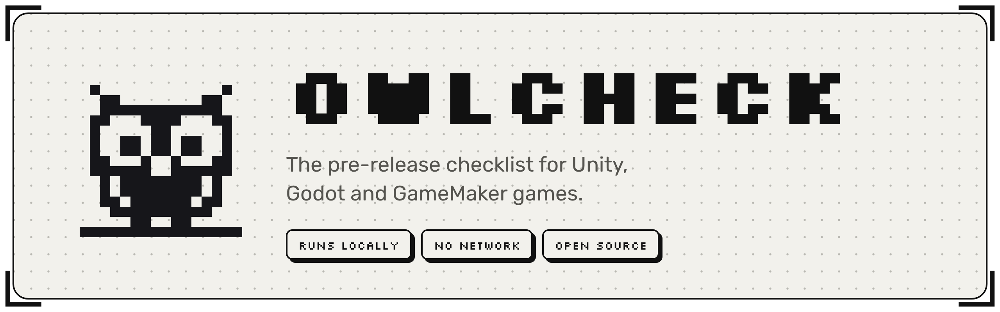
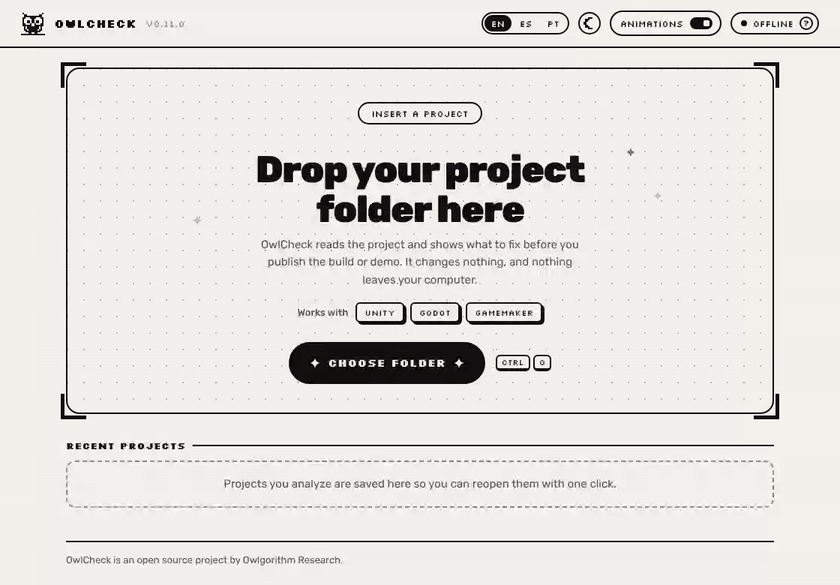
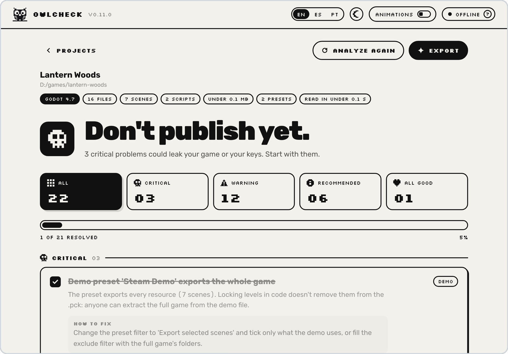
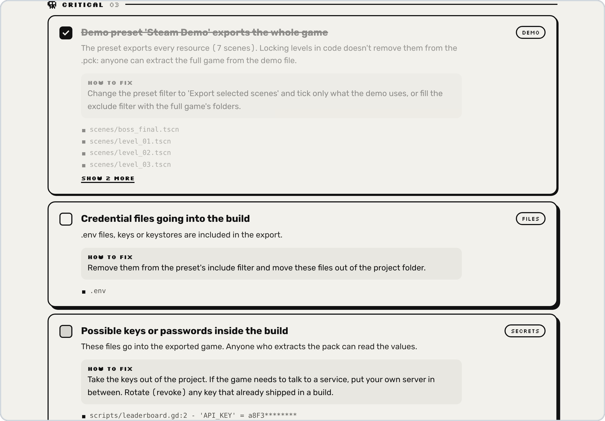
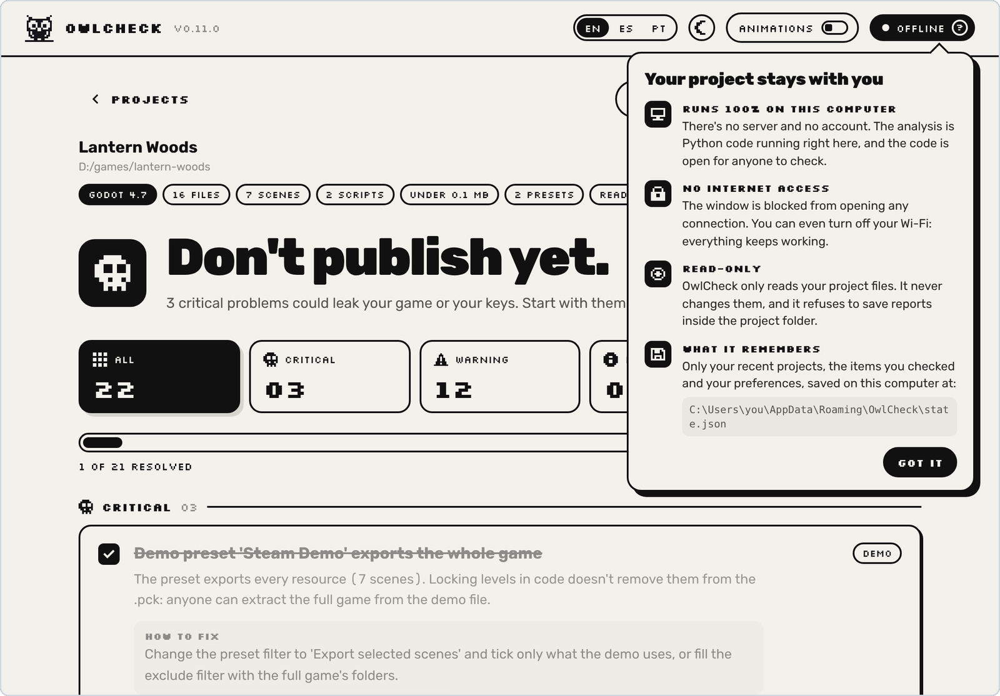
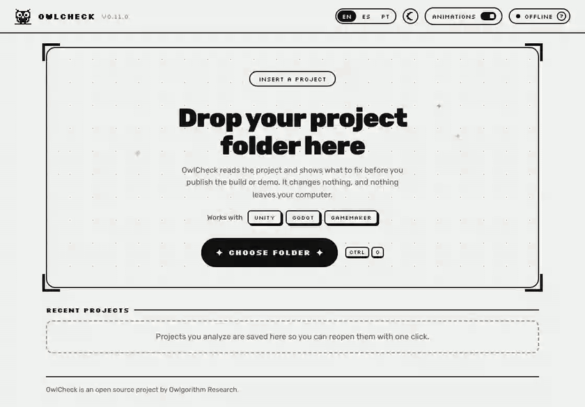
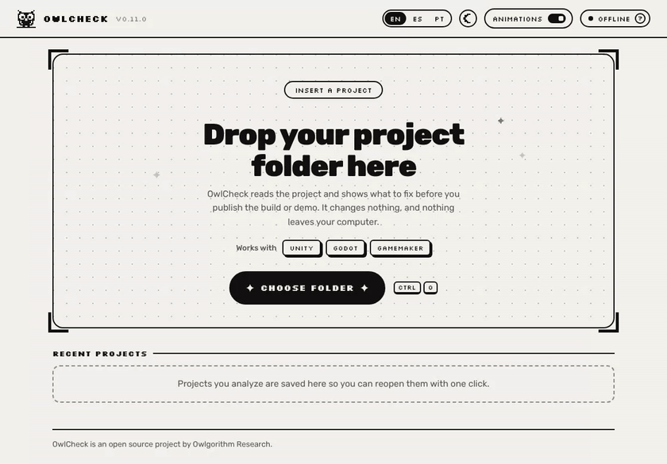

<picture>
  <source media="(prefers-color-scheme: dark)" srcset="docs/media/header-dark.png">
  
</picture>

<p align="center"><a href="README.md">English</a> &nbsp;|&nbsp; <b>Português</b></p>

O OwlCheck lê o projeto do seu jogo e diz, em linguagem simples, o que corrigir antes de publicar uma build ou uma demo: uma demo que leva o jogo inteiro, uma chave de API esquecida num script, cenas de teste e menus de cheat que ficaram para trás, metadados ainda no padrão da engine, fontes e plugins sem licença.

Ele roda no seu computador, nunca se conecta à internet e nunca altera o seu projeto.

<p align="center">
  
</p>

## Por quê

Jogos indie são extraídos, republicados e vasculhados, e a maioria dos vazamentos não vem de nenhum ataque sofisticado. Vem de uma demo exportada com todas as fases, de uma URL de webhook num script, de um `.env` que entrou no pacote, de um menu de debug que ninguém desligou. O OwlCheck pega esses erros bobos enquanto ainda é barato corrigir.

## Instalação

Baixe o arquivo do seu sistema na [versão mais recente](https://github.com/owlgorithm-research/owlcheck/releases/latest). Todos os arquivos ali são gerados pelo GitHub Actions a partir deste repositório.

O OwlCheck ainda não tem assinatura digital, então o Windows e o macOS mostram um aviso na primeira vez que você abre. Os passos abaixo dizem onde clicar.

### Windows 10 e 11

**Com o instalador**

1. Baixe o `OwlCheck-Setup.exe` e abra.
2. Se aparecer *O Windows protegeu o computador*, clique em **Mais informações** e depois em **Executar assim mesmo**.
3. Escolha o idioma, clique em **Avançar** e decida se quer um atalho na área de trabalho.
4. Deixe **Abrir o OwlCheck** marcado e clique em **Concluir**.

Ele instala só para o seu usuário, sem pedir senha de administrador, e coloca o OwlCheck no menu Iniciar. Para atualizar, rode o instalador da versão nova por cima: os projetos recentes e os itens marcados continuam lá. Para desinstalar, abra *Configurações > Aplicativos > Aplicativos instalados*, encontre o OwlCheck e escolha **Desinstalar**.

**Portátil, sem instalar**

1. Baixe o `OwlCheck-Windows.zip`, clique com o botão direito e escolha **Extrair Tudo**.
2. Abra a pasta `OwlCheck` e dê dois cliques em `OwlCheck.exe`. Na primeira vez, o Windows mostra o mesmo aviso de antes.

O `OwlCheck.exe` precisa dos arquivos que estão ao lado dele. Para mudar de lugar, mova a pasta inteira.

> Em PCs com o Controle Inteligente de Aplicativos ligado, o Windows bloqueia apps sem assinatura e não oferece nenhum jeito de abrir. O OwlCheck vai abrir nesses PCs quando estiver assinado.

### macOS

Para Macs com Apple silicon (M1 ou mais novo).

1. Baixe o `OwlCheck-macOS.zip` e dê dois cliques nele para obter o `OwlCheck.app`.
2. Arraste o `OwlCheck.app` para a pasta **Aplicativos**.
3. Abra. O macOS diz que não conseguiu verificar o app; clique em **Concluído**.
4. Abra *Ajustes do Sistema > Privacidade e Segurança*, role até a mensagem sobre o OwlCheck e clique em **Abrir Mesmo Assim**. Confirme com a sua senha ou com o Touch ID.

Daí em diante ele abre como qualquer outro app. Para atualizar, substitua o app na pasta Aplicativos pela versão nova. Para desinstalar, arraste para o Lixo; as preferências ficam em `~/Library/Application Support/OwlCheck`.

### Linux

Para PCs de 64 bits, gerado no Ubuntu 22.04.

```bash
tar -xzf OwlCheck-Linux.tar.gz
./OwlCheck
```

Se a janela não abrir, instale as bibliotecas do sistema que ele usa (nomes do Debian e do Ubuntu):

```bash
sudo apt install libegl1 libxkbcommon-x11-0 libxcb-cursor0 libnss3
```

As preferências ficam em `~/.config/owlcheck`.

### Conferir o download

Cada versão traz um `SHA256SUMS.txt`. Para confirmar que o arquivo não foi alterado no caminho, compare o hash dele com o que está na lista:

| Sistema | Comando |
|---|---|
| Windows (PowerShell) | `Get-FileHash OwlCheck-Setup.exe` |
| macOS | `shasum -a 256 OwlCheck-macOS.zip` |
| Linux | `sha256sum OwlCheck-Linux.tar.gz` |

Também dá para rodar o OwlCheck direto do código: veja [Rodar pelo código](#rodar-pelo-código).

## O que é verificado

O OwlCheck reconhece a engine pela pasta do projeto e roda as verificações que valem para ela.

| | Unity | Godot 4 | GameMaker |
|---|:---:|:---:|:---:|
| Demos que levam o jogo completo | ● | ● | ● |
| Chaves, tokens e senhas que vão para a build | ● | ● | ● |
| Arquivos de credencial (`.env`, keystores, `.pem`) na exportação | ● | ● | ● |
| Arquivos de trabalho (GDDs, anotações, `.psd`) na exportação | ● | ● | ● |
| Cheats, menus de debug e ganchos de linha de comando sem proteção de debug | ● | ● | ● |
| Mensagens de debug e TODOs esquecidos | ● | ● | ● |
| Código fácil de decompilar | Mono ou IL2CPP | scripts em texto | VM ou YYC |
| Conteúdo que sempre vai como está | `Resources`, `StreamingAssets` | filtros de exportação | Included Files |
| Cenas ou rooms de teste na build | ● | | ● |
| Metadados ainda no padrão (nome, empresa, versão, ícone, ID do app) | ● | ● | ● |
| Fontes e plugins sem licença | ● | ● | ● |
| Créditos e registro do uso de IA | ● | ● | ● |

Qualquer outra pasta passa pelas verificações gerais (segredos, credenciais, licenças, registro de IA), e o OwlCheck avisa isso no resultado.

<p align="center">
  <picture>
    <source media="(prefers-color-scheme: dark)" srcset="docs/media/results-dark.png">
    
  </picture>
</p>

Cada item explica o que está errado, por que importa e como corrigir, com os arquivos envolvidos. Marque os itens conforme for resolvendo: o OwlCheck lembra o que você marcou em cada projeto. O checklist pode ser exportado como página HTML ou em Markdown, para colar num gerenciador de tarefas. Há um relatório completo de exemplo em [examples](examples/owlcheck-report.md).

<p align="center">
  
</p>

## Privacidade

O OwlCheck foi feito para olhar projetos que ainda não saíram, então ele foi construído para ser fácil de confiar.

- **Roda só no seu computador.** Sem servidor, sem conta, sem telemetria.
- **Não faz nenhuma conexão de rede.** A análise não importa nenhum módulo de rede, e um teste automático quebra o build se alguém adicionar um. A janela tem uma política de conteúdo que bloqueia qualquer conexão.
- **Só lê.** Nunca altera o seu projeto e se recusa a salvar relatórios dentro da pasta dele.
- **É open source.** Leia o código antes de rodar.

Passe o mouse em **offline**, no topo da janela, para ver o que ele faz e não faz e onde guarda as preferências.

<p align="center">
  
</p>

## Detalhes

<table>
  <tr>
    <td width="50%"></td>
    <td width="50%"></td>
  </tr>
  <tr>
    <td>Modo noturno, com transição em pixels.</td>
    <td>Inglês, espanhol e português, no app e nos relatórios.</td>
  </tr>
</table>

As animações desligam com um botão, e já começam desligadas se o seu sistema pede movimento reduzido.

## Linha de comando

A análise é um único arquivo Python, sem dependências (Python 3.9 ou mais novo), então também funciona no terminal ou num pipeline de CI.

```bash
python owlcheck.py caminho/do/seu/projeto
```

Ele mostra o checklist no terminal e salva `owlcheck-report.html` na pasta atual.

| Opção | O que faz |
|---|---|
| `--out PASTA` | Onde salvar os relatórios (padrão: pasta atual) |
| `--md` | Também gera o relatório em Markdown |
| `--json` | Também gera o resultado em JSON |
| `--lang en\|es\|pt` | Idioma do resultado e dos relatórios (padrão: `en`) |
| `--manifest` | Gera o hash SHA-256 de cada arquivo, como prova de que o projeto existia naquela data |
| `--no-html` | Não gera o relatório em HTML |
| `--no-color` | Saída sem cores |

O comando termina com código `1` quando encontra algo crítico, então dá para barrar uma build com problema antes de ela sair.

## Rodar pelo código

```bash
pip install -r requirements-app.txt
python app/app.py
```

No Windows, dê dois cliques em **`Install OwlCheck.bat`**: ele encontra ou instala o Python, prepara tudo dentro da pasta, gera o `OwlCheck.exe` e oferece criar atalhos. O `packaging\build-installer.bat` gera o instalador com o [Inno Setup](https://jrsoftware.org/isinfo.php).

Testes:

```bash
python -m unittest discover -s tests -v
```

## Limites

- **O OwlCheck reduz erros; ele não deixa o jogo impossível de copiar.** Criptografia, IL2CPP, YYC e scripts em binário aumentam o custo de extrair um jogo, mas quem tiver tempo e conhecimento ainda consegue. Trate isso como barreira, não como cofre.
- **A análise é estática e aproximada.** Ela lê arquivos de configuração e código, mas não roda a engine nem segue cada dependência como uma exportação de verdade. Depois de corrigir, abra a build final e confira.
- **A busca por segredos é feita por padrões.** Ela pega os casos comuns, não todos.
- **Testado com** Godot 4.3+, Unity 2021+ (incluindo o Unity 6) e GameMaker 2.3+. As verificações de Unity e GameMaker foram feitas a partir dos formatos de arquivo dessas engines e testadas em projetos públicos. Se algo parecer errado no seu projeto, abra uma issue com o trecho do relatório.

## Traduções

Todos os textos ficam em dois lugares: o catálogo no começo do `owlcheck.py` e o objeto `STR` em `app/ui/index.html`. Um teste falha se faltar algum texto em algum idioma.

## Política de assinatura de código

Assinatura de código gratuita oferecida por [SignPath.io](https://about.signpath.io), com certificado da [SignPath Foundation](https://signpath.org).

- **Quem envia e revisa código:** [membros da Owlgorithm Research](https://github.com/orgs/owlgorithm-research/people)
- **Quem aprova as assinaturas:** [donos da Owlgorithm Research](https://github.com/orgs/owlgorithm-research/people?query=role%3Aowner)

Só são assinados arquivos gerados pelo GitHub Actions a partir deste repositório, e cada pedido de assinatura é aprovado manualmente.

**Privacidade:** o OwlCheck não envia nenhuma informação para outros sistemas em rede. Ele não faz nenhuma conexão de rede; veja [Privacidade](#privacidade).

## Créditos

Feito por **PΛTTRN** ([@bypattern](https://github.com/bypattern)) na **Owlgorithm Research**.

Fontes da interface: [Silkscreen](https://fonts.google.com/specimen/Silkscreen), de Jason Kottke, e [Rubik](https://fonts.google.com/specimen/Rubik), da Hubert & Fischer, ambas sob a SIL Open Font License 1.1.

## Licença

[MIT](LICENSE).
